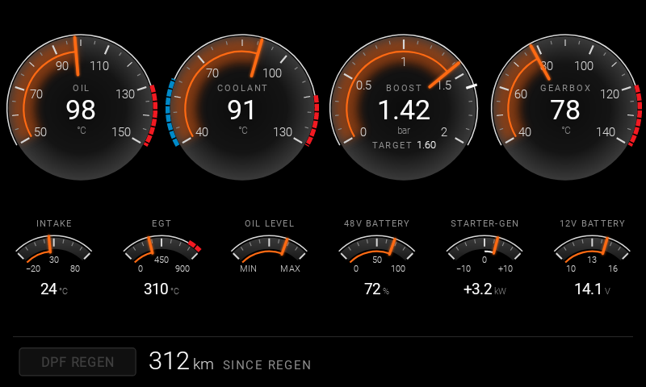

# G-Series Indicators

An Android Auto dashboard for the BMW G31 LCI 520d MHEV (B47 diesel, 48 V mild hybrid, ZF 8HP). It reads the car
through an ELM327-type OBD adapter and draws its own gauges on the car screen, styled after the G31 LCI's Live Cockpit
cluster. It is meant to replace BimmerLink's dashboard while driving.

It is a fork of [tzebrowski/ObdGraphs](https://github.com/tzebrowski/ObdGraphs) and runs on a fork of its OBD library,
[p0nyque/ObdMetrics](https://github.com/p0nyque/ObdMetrics), which adds BMW CAN extended addressing.



## Status

| Part | State |
|---|---|
| Classic dashboard (Android Auto) | Implemented and rendered in tests, on mock data. Not yet run on a head unit. |
| BMW profile and PID file | Written. The DIDs come from BMW's ECU descriptions and are **not yet confirmed on the car**. |
| BMW extended addressing (`6F1` + ECU byte) | In the ObdMetrics fork, unit-tested, not yet tried on the car. |
| Everything inherited from ObdGraphs | Works as upstream: Gauge, Giulia, Trip Info, Performance and Drag Racing screens, DTC read / clear, readiness monitors, trip logs. |

Next step is a car spike: check that the vLinker accepts the extended-addressing AT commands and that one DDE value
decodes. See phases in [the tech design](doc/specs/classic-dashboard-tech.md#5-phases).

## The Classic dashboard

One Android Auto page with 11 fixed indicators: four main dials, six sub-dials and a status strip.

| Slot | Indicator | Source |
|---|---|---|
| M1 | Engine oil temperature | DDE `22 4517` |
| M2 | Coolant temperature | OBD-II `01 05` |
| M3 | Boost, actual and target | DDE `22 4841` / `22 42C8` (fallback `01 0B`) |
| M4 | Gearbox (8HP) oil temperature | EGS `22 DA12` |
| S1 | Intake air temperature | OBD-II `01 0F` |
| S2 | Exhaust gas temperature before the DPF | DDE `22 434A` |
| S3 | Engine oil level | DDE `22 4521` |
| S4 | 48 V battery state of charge | 48 V battery `22 D08C` |
| S5 | Starter-generator power (assist / recuperation) | 48 V battery `22 D08C` |
| S6 | 12 V system voltage | OBD-II `01 42` |
| T1 | DPF regeneration lamp, distance since last regeneration | DDE `22 44BB` / `22 44BF` |

Printed red / blue zones are fixed scale styling, not alerts: this version raises no alerts. Full spec, ranges and
mockups: [doc/specs/classic-dashboard.md](doc/specs/classic-dashboard.md). Wide (1920 × 720) render:
[classic-dashboard-render-1920x720.png](doc/specs/img/classic-dashboard-render-1920x720.png).

## What you need

- **Car:** BMW G31 LCI 520d MHEV. Other F/G-series cars may work with their own profile and DIDs.
- **Adapter:** Vgate vLinker over Bluetooth Classic (the one BimmerLink uses). It has to accept `ATCEA`.
  Most adapters serve one app at a time, so close BimmerLink first.
- **Phone:** Android 8.0+ with Android Auto. A self-built APK only appears in Android Auto with its developer setting
  *Unknown sources* turned on.

## Build

Requires JDK 17 for Gradle, JDK 11 and Maven for ObdMetrics, and the Android SDK. Step-by-step setup for macOS,
including the Android Auto Desktop Head Unit: [SETUP.md](SETUP.md).

1. Build the ObdMetrics fork into `~/.m2` (the app resolves `mavenLocal()` first):

   ```bash
   git clone -b feat/bmw-extended-addressing git@github.com:p0nyque/ObdMetrics.git ../ObdMetrics
   ```

   ```bash
   cd ../ObdMetrics && JAVA_HOME=$HOME/Library/Android/jdk/jdk-11.0.32.1+1/Contents/Home mvn install -Dlombok.delombok.skip=true
   ```

2. Prepare this checkout once. It points `local.properties` at your SDK and writes a placeholder
   `app/google-services.json`, so no crash data goes to upstream's Firebase project:

   ```bash
   ./scripts/setup-local.sh
   ```

3. Build and install the Android Auto variant:

   ```bash
   ./gradlew :app:assembleGiuliaAADebug
   ```

   ```bash
   adb install -r app/build/outputs/apk/giuliaAA/debug/*.apk
   ```

The application id is still upstream's `org.obd.graphs.my.giulia.aa`, so this app and the store version of ObdGraphs
AA cannot be installed side by side.

## Use

1. In the phone app, select the profile **BMW G31 520d MHEV (BT,AA)** and pick the vLinker as the Bluetooth adapter.
2. In Android Auto, open G-Series Indicators and choose **Classic** from the screen list.
3. Without the car: in a debug build set the connection type to **mock**. It answers every PID, so every dial moves.

## Repository layout

| Path | What is there |
|---|---|
| `app` | Phone UI, settings, PID dialogs |
| `automotive` | Android Auto screens; the BMW profile is `src/main/assets/bmw_g31_520d_mhev.properties` |
| `screen_renderer` | Canvas drawing for every screen; the Classic dashboard is `renderer/classic/` |
| `datalogger` | Adapter connections, queries, DTC logic; BMW PIDs in `src/main/resources/bmw_b47_mhev.json` |
| `profile`, `common`, `dragracing`, `screen_behavior`, `integrations` | Upstream modules, unchanged in purpose |
| `doc/specs` | One spec per feature, with mockups and renders in `img/` |
| `scripts` | `setup-local.sh`, the BMW PID generator `gen_bmw_pids.py`, mockup generators |

## Tests

```bash
./gradlew :screen_renderer:testDebugUnitTest
```

```bash
./gradlew :datalogger:testDebugUnitTest
```

```bash
./gradlew spotlessCheck
```

`ClassicRenderTest` draws the whole Classic screen on a real canvas into `screen_renderer/build/classic-render/`, which is
the way to look at it without a head unit. `ClassicPidsTest` decodes every BMW formula with the app's script engine.

## Documentation

- [RESEARCH.md](RESEARCH.md): why this base, the indicator choice, alternatives considered, BMW addressing notes.
- [SETUP.md](SETUP.md): local toolchain, phone and Desktop Head Unit setup.
- [doc/specs/](doc/specs): feature specs, starting with [classic-dashboard.md](doc/specs/classic-dashboard.md) and
  [bmw-extended-addressing.md](doc/specs/bmw-extended-addressing.md).
- [CLAUDE.md](CLAUDE.md): architecture notes, pitfalls and the git workflow for this fork.

The DIDs come from BMW's SGBD ECU descriptions, published as Markdown in
[emdzej/ediabasx-docs-sgbd](https://github.com/emdzej/ediabasx-docs-sgbd).

## Staying in sync with upstream

`upstream` is `tzebrowski/ObdGraphs`. Merge `upstream/master` into `main`; in ObdMetrics, merge `upstream/v11.x` into
`feat/bmw-extended-addressing`. Upstream does not know about the BMW changes, so conflicts are resolved here.

## Credits and licence

Built on [ObdGraphs](https://github.com/tzebrowski/ObdGraphs) and [ObdMetrics](https://github.com/tzebrowski/ObdMetrics)
by Tomasz Żebrowski. Apache License 2.0, see [LICENSE](LICENSE). Not affiliated with or endorsed by BMW AG; BMW is a
trademark of BMW AG.
