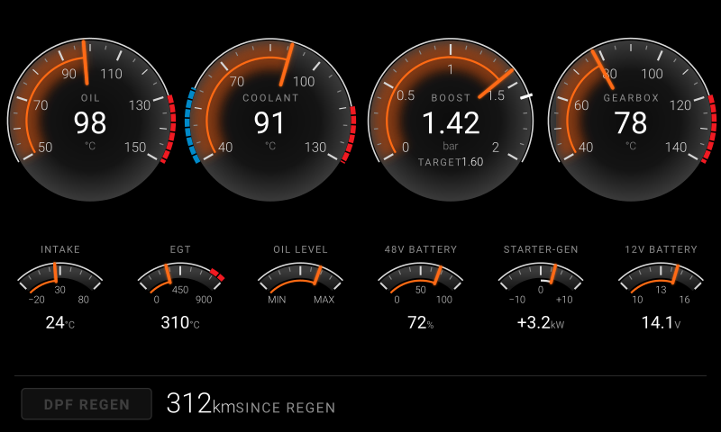

# Spec: Classic dashboard (BMW G31 520d MHEV, Android Auto)

2026-10-19 · Status: phase 1 implemented (screen on mock data, placeholder DIDs); BMW DIDs not yet discovered
(marked **TBD**). Phases: [tech design §5](classic-dashboard-tech.md#5-phases).
Restyled 2026-10-19. The round-dial layout stays. Colours and styling follow the G31 LCI's Live Cockpit cluster
(user's reference photo).

Car screen size, 1920 × 720: [img/classic-dashboard-wide.svg](img/classic-dashboard-wide.svg).
Regeneration running: [img/classic-dashboard-regen.svg](img/classic-dashboard-regen.svg).
The mockups come from `scripts/mockups/classic_dashboard.py`. Change the spec first, then the script.
Tech design (files, phases, open questions): [classic-dashboard-tech.md](classic-dashboard-tech.md).

## Summary

**Problem.** The fork exists to replace BimmerLink's dashboard with gauges that look at home in the car. The existing
screens (Gauge, Giulia, Trip Info, Performance) draw user-picked PIDs in the upstream style. None of them has the car's
own cluster look, a centre-zero dial, a level dial or a telltale lamp.

**Scope.** One new Android Auto screen, *Classic*. It shows a fixed set of 11 indicators on a single page, as round
dials. Colours and styling come from the G31 LCI's Live Cockpit Professional cluster: graphite faces, thin light
edges, an orange glow and progress line up to the value, an orange pointer bar, dark red segmented printed zones and
light numerals. A BMW B47 MHEV vehicle profile and PID file supply the data. No alerts in this version (user's
choice): nothing changes colour or flashes when a value is high. The DPF regeneration lamp is the only exception. It
shows a state, it is not a warning.

## Indicators

Ranges and printed zones are scale design only. Tune them on the car.

| Slot | Indicator | Source | Request | Dial | Scale (numerals) | Printed zones | Readout |
|---|---|---|---|---|---|---|---|
| M1 | Engine oil temp | DDE (`12`) | `22 <DID TBD>` | main | 50–150 °C (50, 70 … 150) | red 130–150 | `98` °C |
| M2 | Coolant temp | OBD-II | `01 05`, id 6 | main | 40–130 °C (40, 70, 100, 130) | blue 40–60, red 115–130 | `91` °C |
| M3 | Boost actual + target | DDE (`12`), fallback `01 0B` (id 99) | actual `22 <DID TBD>`, target `22 <DID TBD>` | main + target marker | 0–2.0 bar (0, 0.5 … 2.0) | — | `1.42` bar, `TARGET 1.60` |
| M4 | Gearbox (8HP) oil temp | EGS (`18`) | `22 <DID TBD>` | main | 40–140 °C (40, 60 … 140) | red 120–140 | `78` °C |
| S1 | Intake air temp | OBD-II | `01 0F`, id 16 | sub | −20–80 °C (−20, 30, 80) | — | `24` °C |
| S2 | Exhaust gas temp before DPF | DDE (`12`), fallback `01 78` | `22 <DID TBD>` | sub | 0–900 °C (0, 450, 900) | red 750–900 | `310` °C |
| S3 | Engine oil level | DDE (`12`), oil condition sensor | `22 <DID TBD>` | sub, level | MIN – MAX (no numbers) | — | none (like a fuel gauge) |
| S4 | 48 V battery state of charge | 48 V battery / DC-DC module (address TBD) | `22 <DID TBD>` | sub | 0–100 % (0, 50, 100) | — | `72` % |
| S5 | Starter-generator power | DDE or BSG module (TBD) | `22 <DID TBD>` | sub, centre-zero | −10–+10 kW (−10, 0, +10) | — | `+3.2` kW |
| S6 | 12 V system voltage | OBD-II | `01 42`, id 67 | sub | 10–16 V (10, 13, 16) | — | `14.1` V |
| T1 | DPF regeneration active + distance since last regen | DDE (`12`) | two DIDs, TBD | lamp + text | — | — | `312 km SINCE REGEN` |

Supporting PID: barometric pressure `01 33` (id 52), used to turn absolute boost into relative boost. It is queried but
not drawn.

Notes per indicator:
- **Boost** is drawn relative to the atmosphere: `absolute − baro`. Until baro arrives, 1.013 bar is used. The DDE
  actual-boost DID is preferred over `01 0B`: that one is 1 byte, capped at 2.55 bar absolute, which full boost on the
  B47 can reach. Actual and target must come from the same scale, so convert both the same way.
- **Starter-generator**: positive = assist (motor), negative = recuperation (charging). Confirm the sign on the car,
  for example by braking from speed, where recuperation should show negative.
- **Oil level**: the scale ends map to the DID's raw MIN / MAX values. Find them with BimmerLink's oil level page.
  Out of range or "not measured" (engine running, sensor still settling) leaves the pointer at rest.
- **Regen**: lamp lit while the regeneration status DID reports active. Text: `N km SINCE REGEN`. While the lamp is
  lit: `Regenerating`. No value: `— km SINCE REGEN`.

Dropped from RESEARCH.md's list by the user: DPF soot loading. Bench items not taken: rail pressure, instant fuel
consumption, AdBlue level.

## Design

### Layout (one page, all indicators)

Three bands across the renderer's visible area, top to bottom:

| Band | Height | Content |
|---|---|---|
| Main row | 55 % | 4 main dials, M1–M4, left to right: oil, coolant, boost, gearbox |
| Sub row | 32 % | 6 sub-dials, S1–S6: intake, EGT, oil level, 48 V, starter-generator, 12 V |
| Status strip | 13 % | Regen lamp at the left, regen text next to it. Thin separator line `#2A2A2A` above. |

- Each band splits its width into equal cells. Main dial diameter = `min(cell width, band height) × 0.94`. Sub-dial
  radius = `min(cell width × 0.48, band height × 0.42)`. On wide screens (e.g. 1920 × 720) the height sets the size,
  and the extra width becomes even gaps between dials. Nothing stretches.
- Order is fixed: engine on the left, electrical on the right. The sub row follows the same grouping.
- Sizes inside a dial scale with its radius (`k = r / 88` main, `r / 64` sub). No text below 11 px.
- At 800 × 480 (DHU default) the main dials are ~180 px across and the sub-dials ~130 px wide. Check both
  800 × 480 and 1920 × 720 before calling it done.

### Main dial (M1–M4)

- 240° sweep, from 7 o'clock to 5 o'clock.
- Face: graphite radial gradient, like the cluster's scale fills: dark in the centre (`#0C0C0C`, `#141414` at 62 %),
  light at the rim (`#3A3A3A`). No bezel ring.
- Edge: a thin light line `#D9D9D9` (1.6) just outside the ticks. It runs along the sweep only, not round the circle.
- Printed zones replace the edge line with a segmented band (5.5 wide, segments 9 on / 1.6 off): dark red `#A8212B`
  for hot, blue `#2F7FD8` for cold (coolant only). Static styling by the user's choice (2026-10-19). They never change
  with the value.
- Ticks: major 12 long / 2.2 wide and half-step 8, both `#D6D6D6`; minor 4.5 / 1.2 in `#8A8A8A`. Numerals sit inside
  the ticks in Roboto light, `#D6D6D6`.
- **Value display** (the cluster's look): an orange glow `#FF5A00` at 42 % opacity, blurred, from the scale start to
  the value inside the ticks, clipped to the face. On top of it, a 2.2-wide progress line `#FF6A13` along the inner end
  of the ticks.
- Pointer: an orange bar `#FF6A13` with a glow, from the edge 47 units inward, pointing at the centre. No needle pivot
  and no hub, so the centre is free for the readout.
- Centre: grey letter-spaced label (`OIL`), white readout (34, regular), grey unit under it.
- Boost target: a short white bar across the edge at the target value, and `TARGET 1.60` under the unit.

### Sub-dial (S1–S6)

- 90° sweep (−45° to +45°), arc above its centre, like the E30 economy meter.
- Graphite band (14 wide, `#3A3A3A` → `#1A1A1A`) with 9 ticks. The light edge line runs outside it, and printed zones
  work as on the main dials (EGT red from 750 °C).
- Progress line inside the band from the scale start to the value, in orange. An orange pointer bar with a glow
  crosses the band.
- Label above the arc. Three numerals inside the arc (min, middle, max), or `MIN` / `MAX` for oil level. Readout and
  unit under the arc (readout 19, regular, white; unit grey). Oil level has no readout, like a fuel gauge.
- Starter-generator is centre-zero: the progress line starts at 0. Assist (positive) is light grey `#E2E2E2`.
  Recuperation (negative) is blue `#2F7FD8`, the cluster's charging colour. The readout always carries a sign.

### Status strip (T1)

- Regen lamp: rounded rectangle, text `DPF REGEN`. Unlit: `#101010` fill, `#2E2E2E` outline, text `#3E3E3E`. It stays
  readable but looks dead, like an unlit cluster lamp. Lit: amber `#FFB000` with a glow, dark text.
- Next to it: `312 km SINCE REGEN` (number white, unit and label grey), or `Regenerating` while the lamp is lit.

### Motion and missing data

- Pointers, glow and progress lines ease towards each new reading, like a damped meter. Reuse `GaugeFrameStates`
  (eased value, staleness).
- No reading yet, or stale: pointer at rest (scale start; 0 for the starter-generator), no glow, readout `--`.
- A value beyond the scale pins the pointer at the end. The readout still shows the real value.
- Not connected: everything at rest, lamp unlit, `— km SINCE REGEN`.

### Type and colour tokens

| Token | Value | Use |
|---|---|---|
| `ink` | `#FFFFFF` | readouts |
| `num` | `#D6D6D6` | numerals, major ticks |
| `dim` | `#8E8E8E` | labels, units |
| `minor` | `#8A8A8A` | minor ticks |
| `edge` | `#D9D9D9` | edge lines |
| `graphite` | `#0C0C0C` → `#3A3A3A` | dial faces; sub-dial bands `#3A3A3A` → `#1A1A1A` |
| `orange` | `#FF6A13` | pointers, progress lines |
| `glow` | `#FF5A00` at 42 % | value glow on the main dials |
| `red` | `#A8212B` | printed hot zones |
| `blue` | `#2F7FD8` | printed cold zone, recuperation |
| `assist` | `#E2E2E2` | starter-generator assist |
| `amber` | `#FFB000` | lit regen lamp |

Font: Roboto, light for numerals and regular for readouts. The cluster's BMW Type Next is not licensed for us.
Roboto's light weight comes closest and ships on every device. The background stays black in day and night.

## Settings / keys touched

- New `SurfaceRendererType.CLASSIC` (next free code, 6), selectable from the AA screen switcher like the others.
- No per-indicator settings: slots and PIDs are fixed in code (`ClassicDials`). The PID lists and dialogs of the other
  screens are untouched.
- New profile `bmw_g31_520d_mhev.properties` (AA assets). Header table:

  | Entry | `id_value` | Header | Extended address | Receive | Description |
  |---|---|---|---|---|---|
  | `mode_1` | `"01"` | `7E0` (proposed; `7DF` may draw two replies, tech design Q5) | — | — | OBD-II |
  | `mode_2` | `"22"` | `6F1` | `"12"` | `"612"` | DDE |
  | `mode_3` | `"EGS"` | `6F1` | `"18"` | `"618"` | EGS |
  | `mode_4` | `"BAT48"` | `6F1` | TBD | TBD | 48 V battery / DC-DC |

  `pref.pids.registry.list=[mode01.json, mode01_2.json, bmw_b47_mhev.json]`.
- New PID file `bmw_b47_mhev.json` in `datalogger/src/main/resources/` (found by the class loader like ObdMetrics' own files; no jar rebuild per DID). Ids `40001`–`40099`
  (free: the highest id in use is 36000). EGS and 48 V PIDs carry `"overrides": {"canMode": "EGS"}` / `"BAT48"`.

## Implementation

Files, data flow, decisions, phases and open questions: [classic-dashboard-tech.md](classic-dashboard-tech.md).
In short: `ClassicSurfaceRenderer` + standalone `ClassicDrawer` (not an `AbstractDrawer`: it would inherit the theme
and Giulia-scoped settings) in `renderer/classic/`, pure `ClassicDials` / `ClassicReadings` / `ClassicLayout`, a
static-layer bitmap per area size, `ClassicQueryStrategy` (`CLASSIC_QUERY`) over ids kept in `ClassicPids`
(`:datalogger`), and `CLASSIC(6)` wired into the AA screen list.

### DID discovery (blocks M1, M3, M4, S2–S5, T1)

1. Deep OBD on the car: list the DDE (`12`), EGS (`18`) and 48 V module jobs. Note each job's DID, length and scaling.
2. Cross-check each value against BimmerLink on the same drive: same reading ± rounding.
3. If a value is missing there, log BimmerLink's requests (vLinker sniffing or a CAN logger on the OBD port).
4. Fill the TBDs in this spec and in `bmw_b47_mhev.json`. Each PID gets `min`/`max` = the indicator's scale.

## Backward compatibility

Additive only: a new screen type, profile and PID file. Existing screens, profiles and prefs are unchanged.
`SurfaceRendererType` codes 0–5 keep their values.

## Tests

See [classic-dashboard-tech.md §7](classic-dashboard-tech.md#7-tests).

## Risks and verification checklist

- [ ] Every TBD DID found and cross-checked against BimmerLink.
- [ ] Refresh rate with four headers in one query. Every switch to an extended entry costs six AT commands. If boost
      feels laggy, check the `TX:` log and group PIDs per ECU, or poll the slow ones less often.
- [ ] Boost: relative value at idle ≈ 0 bar. Target marker moves with load.
- [ ] Starter-generator sign: recuperation shows negative.
- [ ] Oil level MIN / MAX raw values match BimmerLink's oil level page.
- [ ] Regen lamp lights during a regen (EGT ~550–650 °C at the same time) and the distance resets afterwards.
- [ ] DHU check at 800 × 480 and 1920 × 720; then on the car's screen (G31 LCI, ID7). Labels readable at a glance.
- [ ] Frame rate with the glow on (blur), on the DHU and in the car.

## Out of scope

- Alerts or warnings of any kind: colour changes, flashing, sounds, jumping to a value (user: "nothing for now").
- A phone version of the screen.
- User-configurable slots, ranges or colours.
- Day / night or alternative colours, and the cluster's Sport (red) / Eco (blue) themes.
- DPF soot loading, fuel rail pressure, instant fuel consumption, AdBlue level.
